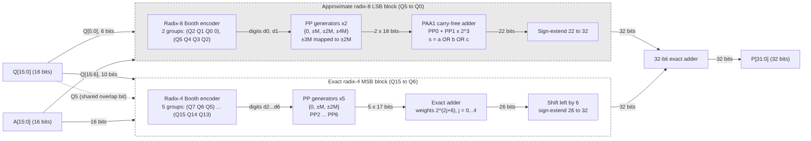

# H²R-MULT: Position-aware Hybrid Radix-4/8 Booth Multiplier

Supplementary material for the manuscript *"H²R-MULT: A Position-aware Hybrid radix-4/8 Booth Multiplier with Hard-multiple Approximation for Energy Efficient Edge Computing"*.

This repository documents the **design, verification and evaluation flow** of H²R-MULT as pseudocode and diagrams. The Verilog RTL, testbenches and scripts are available from the corresponding author upon reasonable request.

## Overview

H²R-MULT is a signed 16 × 16-bit Booth multiplier that splits the multiplier operand `Q` into two regions:

| Region | Bits | Encoding | Partial products | Exactness |
|---|---|---|---|---|
| LSB | Q5 … Q0 | radix-8 | 2 (PP0, PP1) | approximate: ±3M → ±2M, PAA1 accumulation |
| MSB | Q15 … Q6 | radix-4 | 5 (PP2 … PP6) | exact |
| Boundary | Q5 | shared bit | — | exact (bit-overlap synchronisation) |

Seven partial products in total (radix-4: 8, radix-8: 6).

Two variants:

- **H²R-MULTv1**: exact 32-bit final adder.
- **H²R-MULTv2**: minimum-hardware variant; the two radix-8 LSB partial products are omitted and Q5 is used only as the reference bit of the first radix-4 group.

## Repository map

| File | Content |
|---|---|
| [docs/01_architecture.md](docs/01_architecture.md) | Radix partitioning, encoding windows, v1 vs v2 |
| [docs/02_rtl_pseudocode.md](docs/02_rtl_pseudocode.md) | Pseudocode of every RTL block |
| [docs/03_error_analysis.md](docs/03_error_analysis.md) | How ER, MED, NED, MRED, NRED, WCE were measured; results |
| [docs/04_hardware_power.md](docs/04_hardware_power.md) | Vivado flow for area, timing and SAIF-based power |
| [docs/05_image_processing.md](docs/05_image_processing.md) | MATLAB → testbench → MATLAB image pipeline, PSNR/SSIM, latency |
| [docs/06_verification.md](docs/06_verification.md) | Exactness and bit-overlap verification |
| [results/](results/) | Error-distribution histogram and worst-case metrics |
| [Reference/](Reference/) | RTL and testbenches of the compared designs (AxEnMULT-XS, EvoApprox, HBDM-4) |
| [diagrams/](diagrams/) | Mermaid sources (`.mmd`) and rendered `.svg` / `.png` |

## Tools

| Purpose | Tool |
|---|---|
| RTL design | Verilog HDL |
| Simulation | QuestaSim / Vivado Simulator (xsim) |
| Synthesis, implementation, power | AMD Vivado 2024.2, Artix-7 XC7A35T-1CPG236 (Basys-3), 100 MHz |
| Error metrics | Python (NumPy, pandas) |
| Image I/O, PSNR, SSIM | MATLAB |

## Main results (as reported in the paper)

| Design | MRED (10⁻²) | NED (10⁻²) | MED | NRED | ER |
|---|---|---|---|---|---|
| H²R-MULTv1 | 0.2252 | 0.0033 | 1.43 × 10⁵ | 0.53 × 10⁻³ | 82.2 % |
| H²R-MULTv2 | 0.4339 | 0.0062 | 2.65 × 10⁵ | 0.99 × 10⁻³ | 98.4 % |

Hardware and image-quality results: see Table 6 and Table 7 of the paper and [docs/04](docs/04_hardware_power.md), [docs/05](docs/05_image_processing.md).

## Citation

If you use this material, please cite the paper (citation will be added after publication).
