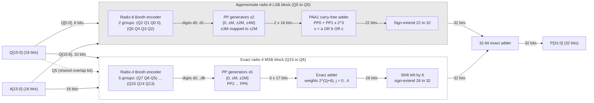
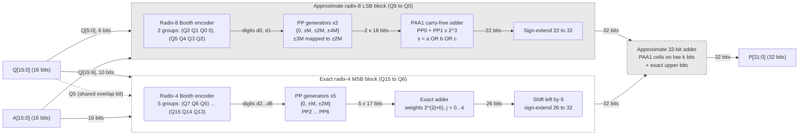

# 1. Architecture

## 1.1 Radix partitioning

The 16-bit signed multiplier `Q` is split into a 6-bit LSB region (radix-8) and a 10-bit MSB region (radix-4).

```
 bit:   15 14 13 12 11 10  9  8  7  6 | 5  4  3  2  1  0  (-1)
        <------- radix-4 (exact) ----> <-- radix-8 (approx) -->
                                     ^
                                     Q5 shared by both regions
```

**Radix-8 windows (LSB):**

| Group i | Window (b2 b1 b0 b-1) | Weight |
|---|---|---|
| 0 | Q2 Q1 Q0 Q-1 (Q-1 = 0) | 2⁰ |
| 1 | Q5 Q4 Q3 Q2 | 2³ |

**Radix-4 windows (MSB):**

| Group j | Window (b1 b0 b-1) | Weight | Partial product |
|---|---|---|---|
| 0 | Q7 Q6 Q5 | 2⁶ | PP2 |
| 1 | Q9 Q8 Q7 | 2⁸ | PP3 |
| 2 | Q11 Q10 Q9 | 2¹⁰ | PP4 |
| 3 | Q13 Q12 Q11 | 2¹² | PP5 |
| 4 | Q15 Q14 Q13 | 2¹⁴ | PP6 |

Digit definitions:

```
radix-8:  d_i = -4*q(3i+2) + 2*q(3i+1) + q(3i) + q(3i-1)      d_i in {0, ±1, ±2, ±3, ±4}
radix-4:  r_j = -2*q(2j+7) +   q(2j+6) + q(2j+5)              r_j in {0, ±1, ±2}
```

## 1.2 Hard-multiple remapping (radix-8)

| Window | Conventional | Proposed |
|---|---|---|
| 0000, 1111 | 0 | 0 |
| 0001, 0010 | +1M | +1M |
| 0011, 0100 | +2M | +2M |
| 0101, 0110 | **+3M** | **+2M** |
| 0111 | +4M | +4M |
| 1000 | −4M | −4M |
| 1001, 1010 | **−3M** | **−2M** |
| 1011, 1100 | −2M | −2M |
| 1101, 1110 | −1M | −1M |

The 3M and 2M inputs of the partial-product multiplexer share the same shifted operand, so no adder for `M + 2M` is needed.

## 1.3 Variants

**H²R-MULTv1:** exact final adder



**H²R-MULTv2:** PAA1 cells on the low `k` bits of the final adder



| Block | v1 | v2 |
|---|---|---|
| Radix-4 MSB block | exact | exact |
| Radix-8 encoding | ±3M → ±2M | ±3M → ±2M |
| PP0 + PP1 accumulation | PAA1 | PAA1 |
| Final 32-bit adder | exact | low `k` bits PAA1, upper bits exact |

## 1.4 PAA1 cell

```
sum   = a OR b OR c_in
c_out = (a OR b) AND c_in
```

Error versus exact addition: `(a + b) - (a OR b) = a AND b` (bits where both inputs are 1).
