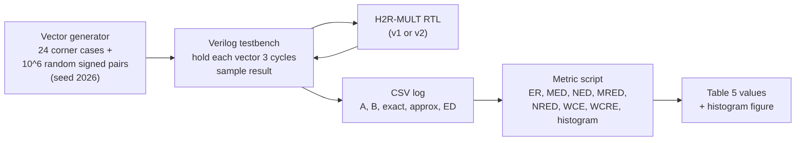
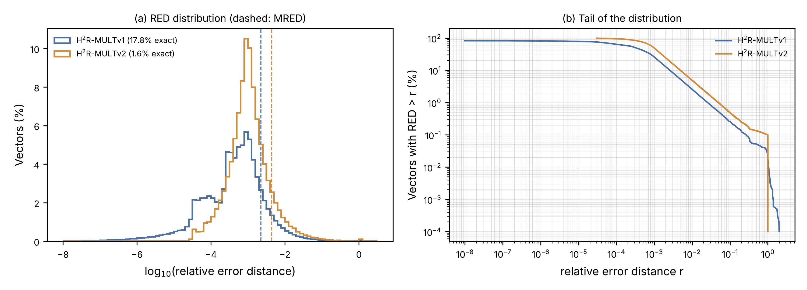

# 3. Error analysis

## 3.1 Flow



## 3.2 Test vectors

| Item | Setting |
|---|---|
| Random vectors | 1,000,000 uniformly distributed signed 16-bit pairs (A, B) |
| Seed | 2026 (fixed, reproducible) |
| Directed corner cases | 24 (operand extremes, both radix-8 digits = ±3, values around the radix-4/radix-8 boundary) |
| Timing | each vector held for 3 clock cycles, then the result is sampled |

Corner cases include, for example: `0×0`, `1×1`, `−1×−1`, `32767×32767`, `−32768×−32768`, `32767×−32768`, `100×27` (Q5…Q0 = 011011, both digits +3), `100×−37` (both digits −3), `1000×{31, 32, 62, 63, 64, 65}` (overlap boundary), `0x5555×0x5555`, `0xAAAA×0xAAAA`.

## 3.3 Testbench pseudocode

```
TESTBENCH error_tb
    open "results.csv"; write header "A, B, exact, approx, ED"
    apply reset

    FOR each (a, b) IN corner_cases + random_pairs(seed = 2026, n = 10^6):
        drive inputs A = a, B = b
        wait 3 clock cycles
        exact  <- a * b                         // reference product
        approx <- DUT.P                         // H2R-MULT output (signed)
        ED     <- |approx - exact|
        write a, b, exact, approx, ED to CSV
    END FOR
    close file
END
```

## 3.4 Metric definitions

For N vectors with exact product `P` and approximate product `P'`:

| Metric | Definition |
|---|---|
| ED | \|P' − P\| |
| ER | fraction of vectors with ED ≠ 0 |
| MED | mean(ED) |
| NED | MED / 2³² |
| MRED | mean(ED / \|P\|), vectors with P = 0 excluded |
| NRED | MED / mean(\|P\|) |
| WCE | max(ED) |
| WCRE | max(ED / \|P\|) |

## 3.5 Metric script pseudocode

```
READ results.csv -> arrays A, B, exact, approx
ASSERT exact == A * B                           // sanity check of the log

ED   <- |approx - exact|
nz   <- (exact != 0)

ER   <- 100 * count(ED != 0) / N
MED  <- mean(ED)
NED  <- MED / 2^32
MRED <- 100 * mean(ED[nz] / |exact[nz]|)
NRED <- MED / mean(|exact|)
WCE  <- max(ED)
WCRE <- 100 * max(ED[nz] / |exact[nz]|)

histogram of log10(ED/|exact|) -> error-distribution figure
WRITE metrics to spreadsheet
```

Statistical confidence: with 10⁶ samples the standard error of the mean metrics is below 1 % of their value (95 % confidence interval within ±2 %).

## 3.6 Analytical bounds (Section III of the paper)

| Quantity | Result |
|---|---|
| Radix-8 digit error | ε_i = sgn(d_i)·δ_i ∈ {−1, 0, +1} |
| Max encoding error | 9\|M\| (both digits ±3 with the same sign) |
| P(±3M) per group | 1/4 |
| P(at least one group approximated) | 7/16 |
| Mean \|encoding error\| | (35/16)\|M\| |
| PAA1 accumulation error | PP0 AND (8·PP1) |
| Tight worst case of total error | 32\|M\| (exhaustive: 64 patterns × 2¹⁶ multiplicands) |

## 3.7 Results (paper, Table 5)

| Design | MRED (10⁻²) | NED (10⁻²) | MED | NRED | ER |
|---|---|---|---|---|---|
| H²R-MULTv1 | 0.2252 | 0.0033 | 1.43 × 10⁵ | 0.53 × 10⁻³ | 82.2 % |
| H²R-MULTv2 | 0.4339 | 0.0062 | 2.65 × 10⁵ | 0.99 × 10⁻³ | 98.4 % |
| AxEnMULT-XS [2] | 1.49 | 0.496 | 2.13 × 10⁷ | — | — |

MRED reduction versus AxEnMULT-XS: 84.9 % (v1) and 70.9 % (v2).

## 3.8 Worst-case behaviour and error distribution

| Metric | H²R-MULTv1 | H²R-MULTv2 |
|---|---|---|
| ER | 82.2 % | 98.4 % |
| WCE | 32\|M\| | 32\|M\| |
| WCRE | ≈ 200 % | 100 % |
| Median RED | 0.032 % | 0.098 % |
| Vectors with RED < 1 % | 97.4 % | 95.1 % |



Full table: [results/error_metrics.md](../results/error_metrics.md).
