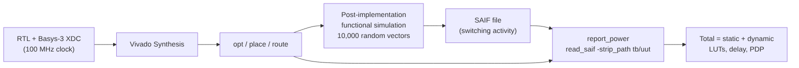

# 4. Area, timing and power

## 4.1 Flow



## 4.2 Settings

| Item | Setting |
|---|---|
| Tool | AMD Vivado 2024.2 (Vivado Synthesis + Implementation) |
| Device | Artix-7 XC7A35T-1CPG236 (Basys-3 board) |
| Clock | 100 MHz (period 10 ns) |
| Constraints | Basys-3 XDC (clock on W5, LVCMOS33 I/O) |
| Area | LUTs and registers after place-and-route (`report_utilization`) |
| Delay | critical-path data delay (`report_timing_summary`) |
| Power | `report_power` after route, switching activity from SAIF |
| Operating point | VCCINT = 1.0 V, ambient 25 °C, typical process, default airflow |

## 4.3 Implementation pseudocode (Vivado Tcl, simplified)

```
create project, part = xc7a35tcpg236-1
add RTL sources + Basys-3 XDC
run synthesis
run implementation (opt_design, place_design, route_design)
report_utilization       -> LUTs, registers
report_timing_summary    -> worst negative slack, critical-path delay
```

## 4.4 Switching activity (SAIF) pseudocode

```
// 1. power testbench: 10,000 random signed vectors, seed 2026, each held 3 cycles
// 2. run Post-Implementation Functional Simulation (xsim), runtime 0 ns, then:

open_saif  activity.saif
log_saif   all nets under /tb/uut
run all
close_saif

// 3. back in the implemented design:
read_saif  -strip_path tb/uut  activity.saif
report_power -file power_saif.rpt
```

Acceptance checks for a valid power report:

```
- "Power analysis from Implemented netlist"
- design nets matched by SAIF  >= 90 %
- confidence level = High
```

## 4.5 Reported quantities

```
Total on-chip power = device static + dynamic (clocks + logic + signals + I/O)
PDP [pJ]            = critical-path delay [ns] x total power [mW]
```

## 4.6 Example: exact hybrid baseline (all approximations disabled)

| Quantity | Value |
|---|---|
| LUTs  | 394  |
| Critical-path delay | 10.341 ns |
| Total on-chip power | 111 mW  |
| SAIF annotation | 93 % of nets, confidence High |
| Junction temperature | 25.6 °C |
| PDP | 1147.851 pJ |

## 4.7 Results

The full comparison (H²R-MULTv1, H²R-MULTv2, exact baseline and prior designs) is given in Table 6 of the paper.
