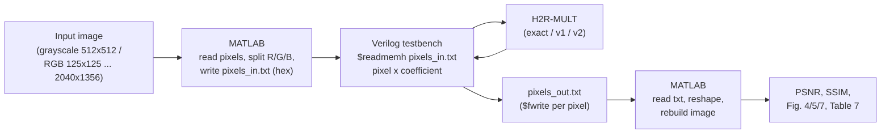

# 5. Image processing evaluation

## 5.1 Flow



The multiplier is evaluated at application level: every pixel is multiplied by a fixed coefficient in the H²R-MULT RTL, and the image is rebuilt from the hardware output. No software filtering (smoothing, sharpening, upscaling) is applied to the output.

## 5.2 Test images

| Set | Images | Size |
|---|---|---|
| Grayscale | Lena, Cameraman | 512 × 512 |
| RGB (raw, uncompensated) | high-definition test pictures | 125 × 125, 512 × 512, 1920 × 1080, 2040 × 1356 |

## 5.3 Step 1: MATLAB, image to text

```
img <- imread(input_image)
IF img is RGB:
    channels <- {R, G, B}                       // process each channel
ELSE:
    channels <- {gray}

FOR each channel ch:
    pix <- reshape(ch, 1, rows*cols)            // row-major stream
    write each pixel as 4-digit hex, one per line -> "pixels_in_<ch>.txt"

save rows, cols, number of channels -> "meta.txt"
```

## 5.4 Step 2: Verilog testbench, pixel stream through the multiplier

```
TESTBENCH image_tb
    load "pixels_in_<ch>.txt" into memory mem[]  ($readmemh)
    open "pixels_out_<ch>.txt" for writing
    apply reset

    FOR n IN 0 .. N_pixels-1:
        A <- coefficient                        // fixed multiplier coefficient
        B <- mem[n]                             // pixel value (sign-extended to 16 bit)
        wait for result valid
        y <- DUT.P >> scale_shift               // back to pixel range
        y <- clip(y, 0, 255)
        write y (decimal) to "pixels_out_<ch>.txt"
    END FOR
    close file
END
```

The same testbench is run with the exact design, H²R-MULTv1 and H²R-MULTv2.

## 5.5 Step 3: MATLAB, text to image and quality metrics

```
FOR each channel ch:
    y      <- read "pixels_out_<ch>.txt"
    out_ch <- reshape(y, rows, cols)
out_img <- concatenate channels (RGB) or out_ch (grayscale)
imwrite(out_img, "output_<design>.png")

ref_img <- output of the exact design (same pipeline)
PSNR    <- psnr(out_img, ref_img)
SSIM    <- ssim(out_img, ref_img)
```

## 5.6 Results (paper)

**Grayscale (Table 7):**

| Image | H²R-MULTv1 | H²R-MULTv2 |
|---|---|---|
| Lena | 27.0 dB | 26.3 dB |
| Cameraman | 30.2 dB | 29.1 dB |

**RGB, raw uncompensated output:** average PSNR 11.84 dB, SSIM ≈ 0.75 over the four resolutions. The low PSNR comes from a systematic, coefficient-dependent gain error (≈ 1.07 for H²R-MULTv1 with the coefficient used), which SSIM largely ignores; it can be removed by coefficient pre-compensation.

## 5.7 Latency model

```
T_total = N_elements x C_dp x T_clk

N_elements = rows x cols x 3        (RGB)
C_dp       = 11 clock cycles per element
T_clk      = 10 ns (100 MHz)
```

| Resolution | Pixels | Elements (RGB) | Latency |
|---|---|---|---|
| 125 × 125 | 15,625 | 46,875 | 5.16 ms |
| 512 × 512 | 262,144 | 786,432 | 86.51 ms |
| 1920 × 1080 | 2,073,600 | 6,220,800 | 684.29 ms |
| 2040 × 1356 | 2,766,240 | 8,298,720 | 912.86 ms |

Energy per image = power × T_total (e.g. 0.38 mJ for 125 × 125).
