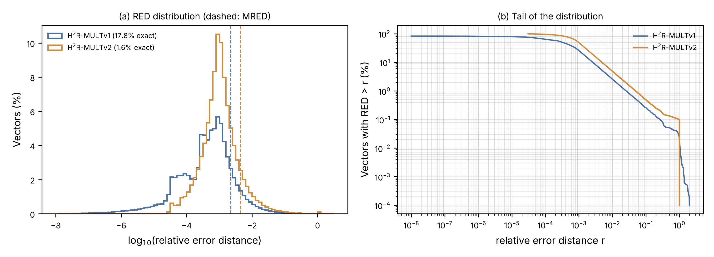

# Error metrics from RTL simulation

Setup: 1,000,000 random signed 16-bit operand pairs (Verilog `$random`, seed 2026) + 24 directed corner cases (1,000,024 vectors), streamed through the RTL (one vector per clock, result checked two cycles later). 30 vectors with a zero exact product are excluded from relative-error metrics.

## Worst-case and distribution metrics

| Metric | H²R-MULTv1 | H²R-MULTv2 |
|---|---|---|
| ER | 82.2 % | 98.4 % |
| WCE (max absolute error) | 1,016,800 = 32\|M\| | 1,048,512 = 32\|M\| |
| WCE / \|M\| (bound) | 32 (tight, Eqs. 10-11) | 32 (exact: \|Q_L\| ≤ 32) |
| WCRE (worst-case relative error) | ≈ 200 % | 100 % |
| Median RED | 0.032 % | 0.098 % |
| 90th / 99th percentile RED | 0.26 % / 2.56 % | 0.49 % / 4.92 % |
| Vectors with RED < 1 % | 97.4 % | 95.1 % |
| Vectors with RED > 10 % | 0.26 % | 0.49 % |
| Worst-case RED, \|Q\| ≥ 64 | 34.8 % | 33.3 % |
| Worst-case RED, \|Q\| ≥ 1024 | 3.04 % | 3.03 % |

Large relative errors occur only for products of very small magnitude, where the LSB error (at most 32|M|) is comparable to the product itself. In H²R-MULTv1, e.g. Q = 4 gives PP0 = −4M and 8·PP1 = +8M, whose carry-free PAA1 combination differs strongly from 4M; in H²R-MULTv2 the output is 0 for |Q| < 32 with Q5 = 0, giving a relative error of 100 %.

Mean metrics (MRED, MED, NED, NRED): see Table 5 of the paper.
